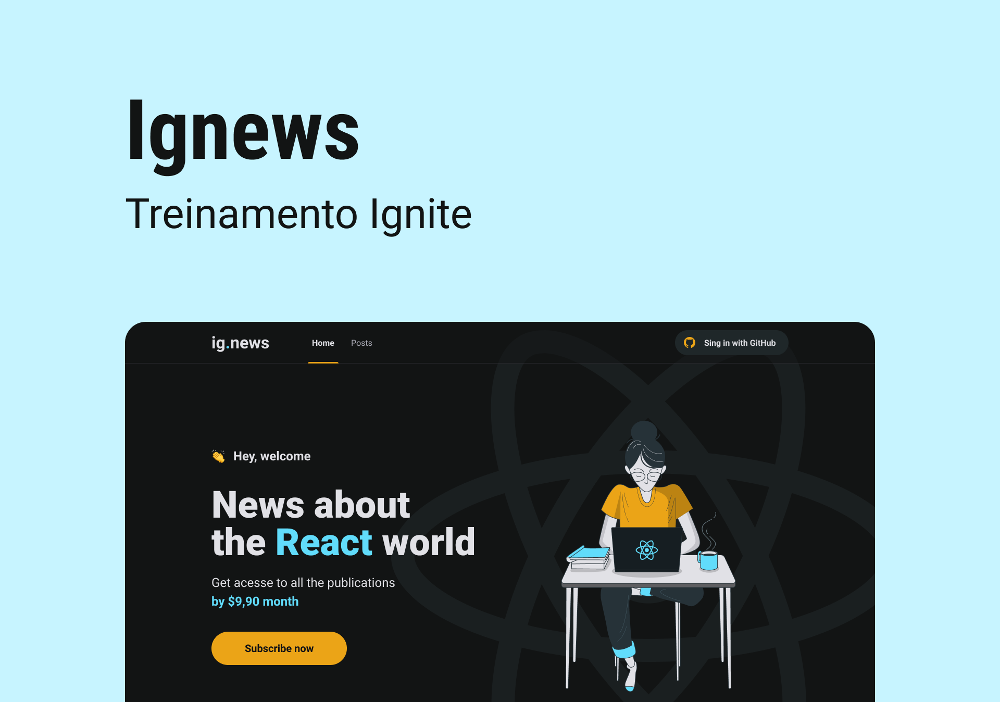

<div align="center"></div>

<div id='about'>
  <h1 align="center">
	  🚧  IgNews 🚀  🚧
  </h1>
  <p align="center">
  	🚀 IgNews is a Newsletter application where users see a preview of an article if they don't have a subscription, can sign up using their GitHub account and subscribe to a monthly plan. After subscribing, they can view and read all articles coming from a CMS.
  </p><br/>
</div>

# Table of Contents

<!--ts-->

- [About](#about)
- [How to run](#how-to-run)
  - [Requirements](#requirements)
- [Technologies](#technologies)
- [Features](#features)
- [Author](#author)
<!--te-->

## About

IgNews is a premium content platform that uses modern technologies to provide a complete subscription experience and access to exclusive articles.

### Key Features

- **Subscription payments**: Integration with **Stripe** to manage recurring billing securely
- **Social login**: Simplified authentication using **Next-Auth** with GitHub provider
- **Content management**: **Prismic CMS** to provide and manage posts flexibly
- **Subscription storage**: **FaunaDB** to store information about users with active subscriptions

## How to run

<div id='how-to-run'>
  <h2>How to run</h2>

  <div id='requirements' display='flex' flex-direction='column'>
    <h3>To run this application you need to install:</h3>
    - [NodeJS](https://nodejs.org/)<br/>
    - [Git](https://git-scm.com/)<br/>
    - It's also good to have an editor to work with the code like [VSCode](https://code.visualstudio.com/)
  </div>
  
  <br/>

First, download this repository to your machine:

```bash
git clone https://github.com/flvSantos15/feedback-widget.git
```

Go to the project folder:

```bash
cd folder-name
```

Then, install dependencies by running:

```bash
yarn
# or
npm install
```

And finally, run the development server:

```bash
npm run dev
# or
yarn dev
```

Open [http://localhost:3000](http://localhost:3000) with your browser to see the result.

</div>

<div id='technologies'>
  <h2>This application is being built using the following technologies:</h2>
  
  ### Frontend
  - [React](https://pt-br.reactjs.org/) - JavaScript library for building user interfaces
  - [TypeScript](https://www.typescriptlang.org/) - JavaScript superset that adds static typing
  - [NextJS](https://nextjs.org/) - React framework for full-stack web applications
  
  ### Backend and Services
  - [Stripe](https://stripe.com/docs/js) - Payment processing and subscription management
  - [FaunaDB](https://fauna.com/) - Serverless database for storing active subscriptions
  - [Prismic-CMS](https://prismic.io/) - Headless CMS for content management
  - [Next-Auth](https://next-auth.js.org/) - Authentication for Next.js applications
</div>

<div id='features'>
  <h2>Features developed during the classes</h2>

- [ x ] Responsive web interface
- [ x ] Social login with GitHub
- [ x ] Stripe payment methods integration
- [ x ] Database integration
- [ x ] Active subscription validation

</div>

<div id='author'>
  <h2>Author</h2>

 
 <br />
 <sub><b>Flavio Santos</b></sub>

Built with ❤️ by Flavio Santos 👋🏽 get in touch!

[](https://www.linkedin.com/in/flvSantos15/)
[](mailto:flvSantos300@gmail.com)

</div>
